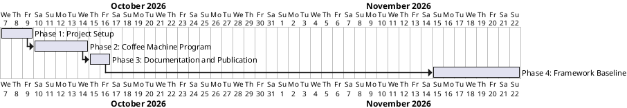

# Project Plan: OOP Coffee Machine

## Metadata
| Key | Value |
| --- | --- |
| ID | PP-001 |
| CrossReference | [BC-001], [SA-001], [MIL-001], [MIL-002], [MIL-003], [MIL-004] |
| Language | en |
| Domain | education |

## Version History
| Date | Status | Author | Reviewer | Change | Commit |
| --- | --- | --- | --- | --- | --- |
| 2026-10-07 | Deprecated | Jens Tirsvad Nielsen | S01 | Initial version | [c24f412] |
| 2026-10-07 | Deprecated | Jens Tirsvad Nielsen | S01 | Accepted after RC-006 (Go) | [c24f412] |
| 2026-11-15 | Accepted | Jens Tirsvad Nielsen | AI as stand-in for S01 | Added the baseline gateway MIL-004, its scope coverage, dependency, risk and Gantt entries; sources on the assumptions; replaced the open issue about the missing QC checklist; set the domain to education; reviewed in autonomous mode, not independent | [5278b45] |

---

## Purpose

Schedules the three phases that deliver the coffee machine repository, as
required by [BC-001], with the communication cadence of [SA-001]. A fourth phase, [MIL-004], was added on 2026-11-15 to bring the finished project to the baseline of the framework.

## Planning Assumptions

- Start date 2026-10-07; one phase per week or less, each ending in a pull request (source: [BC-001], Constraints).
- S01 is owner and reviewer of every phase; S02 and S03 are informed through the README (source: [SA-001], Communication Requirements).
- Nothing under `src/` or `tests/` is written until the milestones are `Accepted` with a `Go` review (source: the plan-first rule of the framework in `framework/`).
- The baseline phase [MIL-004] starts 2026-11-15 and ends by 2026-11-22, one week (source: [BC-001], Constraints). The end date of the plan moves from 2026-10-16 to 2026-11-22 because of it; the reason is the agreed minimum quality baseline of the framework.
- For the baseline phase the review is done by an AI stand-in for S01 (source: [SA-001], Conflicting Interests).

## Gateway Schedule

| Gateway | Document | Window | Decision date | Owner | Stories | Main deliverable | Milestone |
| --- | --- | --- | --- | --- | --- | --- | --- |
| Phase 1: Project Setup | [MIL-001] | 2026-10-07 to 2026-10-09 | 2026-10-09 | S01 | None | Skeleton, `pyproject.toml`, Doxyfile, CI | [Milestone 49] |
| Phase 2: Coffee Machine Program | [MIL-002] | 2026-10-10 to 2026-10-14 | 2026-10-14 | S01 | None | Menu, CoffeeMaker, MoneyMachine, main loop, tests | [Milestone 50] |
| Phase 3: Documentation and Publication | [MIL-003] | 2026-10-15 to 2026-10-16 | 2026-10-16 | S01 | None | README, Doxygen docs, repository description and topics | [Milestone 51] |
| Phase 4: Framework Baseline | [MIL-004] | 2026-11-15 to 2026-11-22 | 2026-11-22 | S01 | none (documentation and technical tasks) | The framework release, the wiki in three languages, the README, the licence metadata, the traceability matrix and the review records | [Milestone 517] |

## Timeline diagram

## Scope Coverage

| Business Case scope item | Gateway |
| --- | --- |
| Package, tests, `pyproject.toml`, `.gitignore`, `constants.py`, Doxyfile | [MIL-001] |
| Coffee machine program and tests | [MIL-002] |
| README, Doxygen build | [MIL-003] |
| Repository description and topics | [MIL-003] |
| The baseline phase: framework release, wiki, README template, licence metadata, traceability matrix, review records | [MIL-004] |

## Dependencies

[MIL-001] precedes [MIL-002], which precedes [MIL-003], which precedes [MIL-004]. A No-Go on a phase moves every later date and the end date of the plan by the rework time; S01 decides the new date.

## Plan Risks

| Risk | Impact | Mitigation |
| --- | --- | --- |
| Review of each document delays the next phase | Medium | S01 reviews in the same session as the draft |
| The git host token cannot set topics through the API | Low | Set the description and topics by hand in the web UI |
| A continuous integration (CI) check fails on the pull request of [MIL-004] | The merge is delayed past 2026-11-22 | The failure is fixed on the same branch and the checks run again; after three failed rounds on one cause the work stops and S01 decides |

## Open Issues

- Dates are proposals; S01 confirms or changes them.
- Tasks are all plain tasks: the course supplies the design, so no use case or user story is modelled. S01 may ask for a use case "User orders a drink".
- The checklist `QC-PP-001` now exists in the framework; this plan is reviewed against it in the baseline phase.
- Which remote receives the repository description and topics (`git.tirsystem.com`, GitHub mirror, or both) is for S01 to confirm; both remotes exist.
- The existing source and tests are not reviewed again in the baseline phase; [RC-007] stays the review of the source code.
- The published wiki is checked on the git host after the merge, because the host copies it only then.

---

[BC-001]: ./business-case.md
[SA-001]: ./stakeholder-analysis.md
[MIL-001]: ./milestones/mil-001-setup.md
[MIL-002]: ./milestones/mil-002-core.md
[MIL-003]: ./milestones/mil-003-docs.md
[c24f412]: https://git.tirsystem.com/Tirsvad-Udemy-100_days_of_code/016-oop_coffee_machine/commit/c24f41207fb15f39b0ad6501e1f3126d3bd9232e
[Milestone 49]: https://git.tirsystem.com/Tirsvad-Udemy-100_days_of_code/016-oop_coffee_machine/milestone/49
[Milestone 50]: https://git.tirsystem.com/Tirsvad-Udemy-100_days_of_code/016-oop_coffee_machine/milestone/50
[Milestone 51]: https://git.tirsystem.com/Tirsvad-Udemy-100_days_of_code/016-oop_coffee_machine/milestone/51
[MIL-004]: ./milestones/mil-004-framework-baseline.md
[RC-007]: ./sqa/reviews/rc-007-source-code-mil-002.md
[Milestone 517]: https://git.tirsystem.com/Tirsvad-Udemy-100-days-of-code/016-oop-coffee-machine/milestone/517
[5278b45]: https://git.tirsystem.com/Tirsvad-Udemy-100-days-of-code/016-oop-coffee-machine/commit/5278b4588919b4665f72ef3eb43a7bb30d4d6c8d
